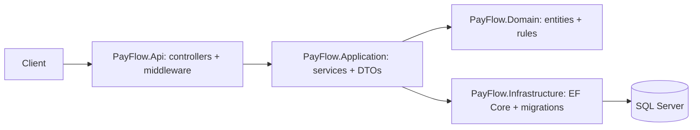

# PayFlow

PayFlow is a .NET 8 bank-style payments REST API for accounts, deposits, withdrawals, same-currency transfers, persistent idempotency, optimistic concurrency, and paged transaction history.

## Stack

ASP.NET Core controller API, EF Core 8 with SQL Server and migrations, Swagger, xUnit, FluentAssertions, Docker Compose, and GitHub Actions.

## Architecture



## Run with Docker

SQL Server has a health check; the API waits for it and applies the committed migration at startup. The default development-only password is `PayFlow_dev_12345!`; override it without committing a secret:

```bash
export PAYFLOW_SQL_PASSWORD='A_strong_local_password123!'
docker compose up --build
```

Open Swagger at <http://localhost:5000/swagger>.

## Run locally

Install .NET 8 and have SQL Server available. Set `ConnectionStrings__DefaultConnection`, then run:

```bash
dotnet restore PayFlow.sln
dotnet build PayFlow.sln
dotnet run --project src/PayFlow.Api --environment Development
```

## API examples

```bash
# Create, read, and balance
curl -X POST http://localhost:5212/api/accounts -H 'Content-Type: application/json' -d '{"ownerName":"Alice","currency":"USD"}'
curl http://localhost:5212/api/accounts/{accountId}
curl http://localhost:5212/api/accounts/{accountId}/balance

# Deposit and withdraw
curl -X POST http://localhost:5212/api/transactions/deposit -H 'Content-Type: application/json' -d '{"accountId":"{accountId}","amount":100.00}'
curl -X POST http://localhost:5212/api/transactions/withdraw -H 'Content-Type: application/json' -d '{"accountId":"{accountId}","amount":25.00}'

# Transfer, with a unique key per logical request
curl -X POST http://localhost:5212/api/transactions/transfer -H 'Content-Type: application/json' -H 'Idempotency-Key: transfer-2026-0001' -d '{"fromAccountId":"{fromId}","toAccountId":"{toId}","amount":50.00}'

# Paged history and health
curl 'http://localhost:5212/api/transactions/{accountId}?page=1&pageSize=20'
curl http://localhost:5212/health
```

All failures use `application/problem+json`. Amounts must be positive, withdrawals cannot overdraw, transfers require existing same-currency accounts, and self-transfers are rejected.

## Design decisions

- A transfer uses one database transaction so the debit, credit, and two history rows commit or roll back together.
- The transfer-out row stores the idempotency key with a unique index. A retry returns the original result; reusing a key with different input is rejected. This survives API restarts.
- `Account.RowVersion` is an EF Core rowversion/concurrency token. A stale update becomes a 409 response instead of silently overwriting a newer balance.
- SQL Server is the production-shaped provider. Integration tests use a real relational SQLite in-memory database so CI needs no external service.
- Validation stays in application use cases; controllers handle HTTP binding and responses.

## Tests

```bash
dotnet test PayFlow.sln
```

Unit tests cover deposits, withdrawals, overdrafts, invalid amounts, transfers, same-account transfers, and currency mismatches. The integration test exercises the HTTP API, two accounts, transfer idempotency, balances, and history paging.

## What I would improve next

Add JWT authentication and ownership authorization, an outbox pattern for reliable events, correlation IDs and tracing, rate limiting and audit trails, Azure SQL/container deployment, and Testcontainers-based SQL Server integration tests for provider-specific coverage.
